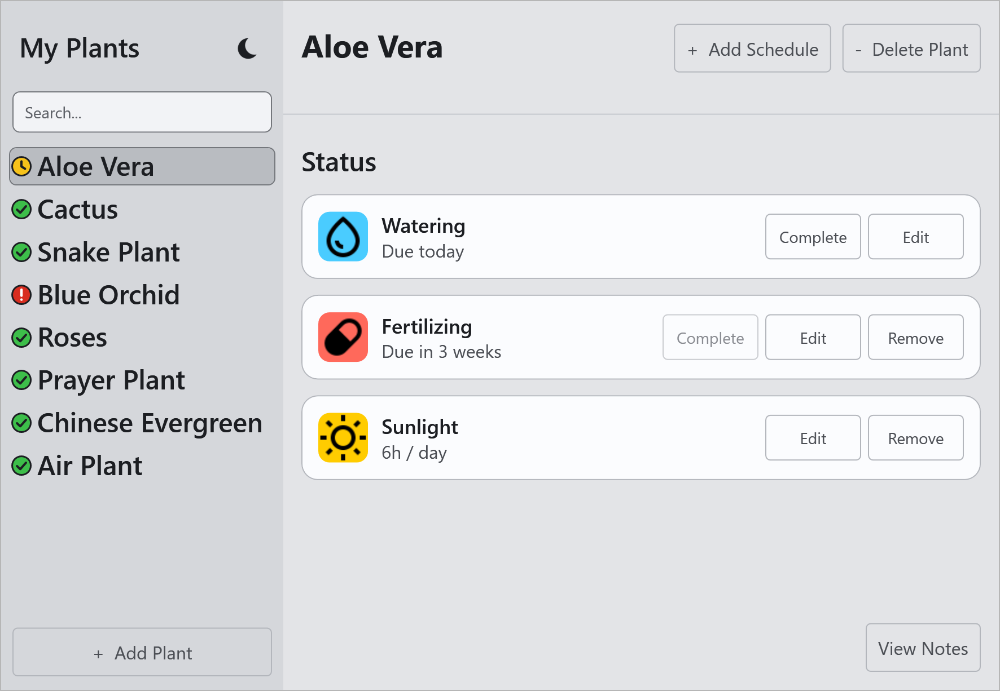
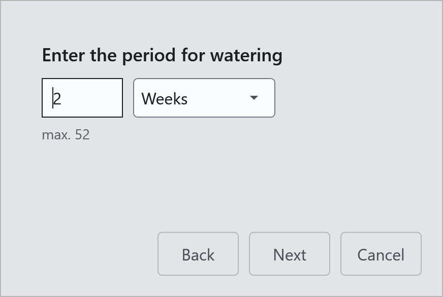
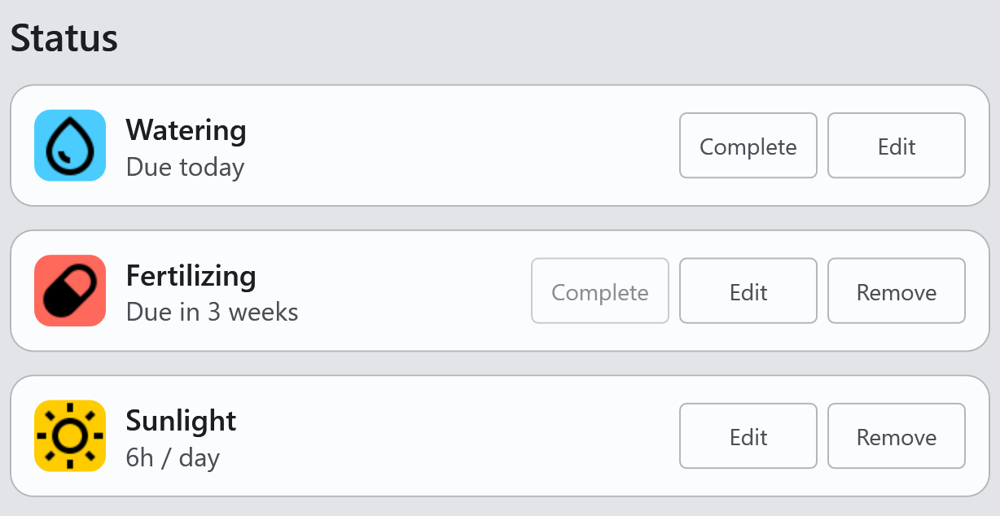
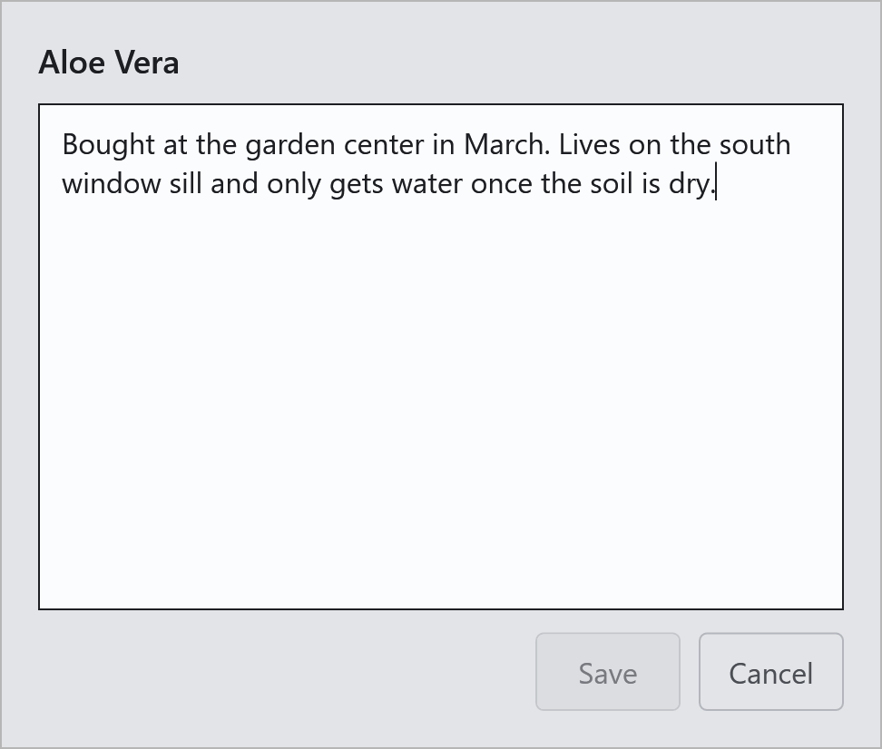

<p align="center">
  <picture>
    <source media="(prefers-color-scheme: dark)" srcset="docs/Banner-dark.png">
    
  </picture>
</p>

<h1 align="center">GreenKeeper</h1>

<p align="center">A Windows desktop app that keeps track of when each of your houseplants needs water, fertilizer and sunlight.</p>

<p align="center">
  <a href="https://github.com/Nosgard/GreenKeeper/actions/workflows/ci.yml"></a>
  <a href="https://github.com/Nosgard/GreenKeeper/releases/latest"></a>
  <a href="https://dotnet.microsoft.com/download/dotnet/9.0"></a>
  
</p>

<p align="center">
  <a href="#download-and-first-start">Download</a> ·
  <a href="#features">Features</a> ·
  <a href="#using-greenkeeper">Using GreenKeeper</a> ·
  <a href="#building-from-source">Building from source</a> ·
  <a href="#tech-stack">Tech stack</a>
</p>

Indoor plants often die without drawing attention. Many people buy a houseplant with good intentions, only to find the soil bone-dry a few weeks later when life gets busy. GreenKeeper helps by creating a watering schedule for each plant, along with an optional fertilizing plan and a sunlight requirement. It counts down to the next due date and instantly shows which plant needs care today. The entire system runs from a single database file on your PC, requiring no account or internet connection. I created this program because this exact problem was happening with my own plants.

<p align="center">
  
</p>
<p align="center"><em>The main window with demo plants, in the bright theme.</em></p>

## Features

- **Care schedules.** Watering is required, fertilizing and sunlight are optional. Intervals run in days, weeks, months or years, sunlight in hours per day, week, month or year.
- **Status at a glance.** A dot next to each plant: green means nothing is due, yellow means something is due today, red means something is overdue.
- **Done with one click.** Complete is enabled on the day a task is due. Clicking it starts the countdown again from that moment.
- **Change anything later.** Edit an interval, remove a schedule you no longer need, add one you skipped, rename the plant.
- **Notes.** Free text per plant: where you bought it, what it likes, what you tried.
- **Search.** The list filters by name as you type.
- **Bright and dark theme.** One click on the toggle in the sidebar; the choice is remembered.
- **Keyboard and screen reader.** Every control has a keyboard path and a spoken name, and the result of an action is announced.
- **Your data stays with you.** One local SQLite file, nothing is sent anywhere.

## Download and first start

Requirements: Windows 10 or 11, 64-bit. Nothing else needs to be installed; the download includes everything the app needs. The zip is about 57 MB, unpacked about 135 MB.

1. Open the [latest release](https://github.com/Nosgard/GreenKeeper/releases/latest) and download the file that ends in `-win-x64.zip`. The two "Source code" files on the same page are not the app.
2. Right-click the downloaded zip, choose **Extract All...** and pick any folder of your own, for example `Documents\GreenKeeper`. The folder has to keep all seven files together.
3. Double-click `GreenKeeper.exe`.
4. Click **+ Add Plant** and enter your first plant. The database is created on this first start.

> [!NOTE]
> On the first start Windows shows **Windows protected your PC**. GreenKeeper is not code-signed, so SmartScreen does not know the file yet. Click **More info**, then **Run anyway**. The dialog comes back once after every new release. The zip comes only from this repository's Releases page and is built by the public [release workflow](.github/workflows/release.yml) from the tagged commit, so you can compare the source with what you run.

### Where your data lives

The program folder is the one you extracted. Your plants are stored separately in `%LocalAppData%\GreenKeeper`: `greenkeeper.db` holds the plants and schedules, `settings.json` the theme and the window position. Copy that folder to back up your plants.

**Updating:** extract the new zip into a new folder, start it once, delete the old folder. Your data is untouched, because it never sits in the program folder. GitHub can tell you about new releases: **Watch**, **Custom**, **Releases**.

**Uninstalling:** delete the program folder. GreenKeeper writes nothing to the Start menu, the registry or any other place. If you also want to remove your plants, delete `%LocalAppData%\GreenKeeper`.

## Using GreenKeeper

### Add a plant

**+ Add Plant** opens a short wizard: the name (up to 50 characters), the watering interval, the optional fertilizing interval, the optional sunlight requirement and a summary. Every step checks its input and shows the maximum for the chosen unit.

<p align="center">
  
</p>
<p align="center"><em>The watering step of the wizard.</em></p>

### Read the status

Each plant in the sidebar carries a dot that sums up all its schedules.

| Dot | Meaning |
|---|---|
|  | Nothing is due. |
|  | A task is due today. |
|  | A task is overdue. |

The dashboard shows one card per schedule. Watering and fertilizing count down and can be completed; sunlight only records what the plant needs.

<p align="center">
  
</p>
<p align="center"><em>Complete is enabled only on the day a task is due or after it.</em></p>

- **Complete** marks the task as done. The next due date is counted from that moment, not from the old due date.
- **Edit** changes the interval. Saving restarts the countdown from the moment you save, also if you keep the old value.
- **Remove** deletes the fertilizing schedule or the sunlight requirement. Watering cannot be removed, every plant keeps one.
- **+ Add Schedule** in the header adds a schedule the plant does not have yet. Picking a type that already exists replaces it, after a question.

The cards and dots refresh themselves every five minutes while the app is open, so a plant that becomes due during the day changes color without a restart.

### Notes and renaming

**View Notes** opens a text window for the selected plant. **Save** keeps the text; closing the window with unsaved changes asks first.

<p align="center">
  
</p>

To rename a plant, right-click its entry in the sidebar (or press the menu key on it) and choose **Rename...**. The schedules and due dates stay as they are.

### Keyboard and screen readers

Everything works without a mouse. The window is split into two regions, the plant list and the dashboard; F6 jumps between them and the arrow keys walk through each one.

| Keys | What happens |
|---|---|
| <kbd>Tab</kbd> / <kbd>Shift</kbd>+<kbd>Tab</kbd> | Next or previous control |
| <kbd>F6</kbd> / <kbd>Shift</kbd>+<kbd>F6</kbd> | Jump between the plant list and the dashboard |
| Arrow keys | Step through the controls of the current region, or through the plants in the list |
| <kbd>Enter</kbd> | Open the focused plant |
| <kbd>Space</kbd> | Open a drop-down list |
| <kbd>Esc</kbd> | Close a dialog without saving |
| Menu key or <kbd>Shift</kbd>+<kbd>F10</kbd> | Open the context menu of a plant (Rename) |

After a dialog closes, the focus returns to the control it came from. Screen readers get the names of the visible labels: a plant entry is announced with its status ("Aloe Vera, due today"), a card button with its card ("Complete Watering"), and the outcome of completing, removing or saving is spoken. The app exposes all of this through Windows UI Automation, the interface Narrator and NVDA read. If something is not announced the way you expect, please [open an issue](https://github.com/Nosgard/GreenKeeper/issues).

## Building from source

You need Windows 10 or 11 (WPF runs only on Windows), the [.NET 9 SDK](https://dotnet.microsoft.com/download/dotnet/9.0) and Git. Visual Studio 2022 or later with the .NET desktop workload is optional.

```powershell
git clone https://github.com/Nosgard/GreenKeeper.git
cd GreenKeeper
dotnet build
dotnet run --project GreenKeeper
```

`dotnet build` compiles both projects, `dotnet run` starts the app. In Visual Studio, open `GreenKeeper.sln` and press F5 instead. A Debug build shows an extra "DEBUG: Simulate" panel under the cards that moves the due dates of the selected plant forward, so overdue states can be tried without waiting. The database is created on the first start in `%LocalAppData%\GreenKeeper`; the EF Core migrations run at startup, there is no `dotnet ef` step.

To build the same self-contained exe the releases ship:

```powershell
dotnet publish GreenKeeper/GreenKeeper.csproj -c Release -r win-x64 --self-contained true -p:PublishSingleFile=true -p:DebugType=none -o publish
```

A release is created by the [release workflow](.github/workflows/release.yml) whenever a `v*` tag is pushed: it builds, runs the tests, publishes with the command above and attaches the zip to a GitHub release.

### Running the tests

```powershell
dotnet test
```

The tests in `GreenKeeper.Tests` use [xUnit](https://xunit.net/) and run in about a second without opening a window. They cover the ViewModels (against fakes for the repository, dialogs and timer), the repository against an in-memory SQLite database, the due date rules, the responsive layout math, the converters and the services. The [CI workflow](.github/workflows/ci.yml) runs the same build and the same tests on every push and pull request to `master`; that is what the badge at the top reports.

## Tech stack

| Area | Technology | What it does in GreenKeeper |
|---|---|---|
| Language and runtime | C# on [.NET 9](https://dotnet.microsoft.com/) | The whole app, from the screens to the database access. |
| Desktop UI | [WPF](https://learn.microsoft.com/dotnet/desktop/wpf/) | Microsoft's framework for Windows desktop apps: the screens are written in XAML, the two themes are resource dictionaries swapped at runtime, and the layout scales with the window size. |
| Architecture | MVVM | The screens only display; ViewModels hold the state and the commands. That is why most of the app can be tested without a window. The base classes (`ObservableObject`, `RelayCommand`, `AsyncRelayCommand`) are written in the project, not taken from a library. |
| Data | [Entity Framework Core 9](https://learn.microsoft.com/ef/core/) with [SQLite](https://www.sqlite.org/) | EF Core stores the plant objects in the database and reads them back without hand-written SQL. SQLite keeps that database in a single file on the PC: no server, no account. |
| Tests | [xUnit](https://xunit.net/) |  The unit tests run locally and in CI with `dotnet test`. |
| CI and releases | [GitHub Actions](https://github.com/features/actions) | Build and tests on every push and pull request; a self-contained win-x64 zip on every version tag. |

Why these: WPF gives a native Windows app with full keyboard and screen reader support out of the box. SQLite was chosen so that a user's data is one file they can copy, and EF Core so that the app's classes map to that file without SQL in the code.

### Project structure

```text
GreenKeeper.sln
GreenKeeper/               the WPF app
  Commands/                RelayCommand and AsyncRelayCommand
  Converters/              value converters for the bindings (status dots, spoken names)
  Database/                DbContext, its factory and the database path
  Layout/                  responsive sizing and the remembered window placement
  Migrations/              EF Core migrations, applied at startup
  Models/                  Plant, CareSchedule, SunlightRequirement and the enums
  Repositories/            PlantRepository, the only place that talks to the database
  Resources/               icons, both themes and the styles
  Scheduling/              the rules for due, due today and overdue
  Services/                dialogs, settings, theme and timer
  ViewModels/              one per window, wizard step and status card
  Views/                   the windows and dialogs, plus the keyboard and focus helpers
GreenKeeper.Tests/         xUnit tests, with fakes for the repository, dialogs and timer
.github/workflows/         ci.yml and release.yml
docs/                      the banner and the screenshots of this README
```

## Known limitations

- Windows only, 64-bit only. There is no macOS, Linux, ARM64 or phone version.
- No installer and no code signing, so the first start goes through the SmartScreen dialog described above.
- Reminders exist inside the app. GreenKeeper does not run in the background and sends no notifications while it is closed.
- One database per Windows user account, no sync and no export.

## Getting help and contributing

Questions and bug reports go to the [issues](https://github.com/Nosgard/GreenKeeper/issues); a report helps most with the Windows version, the app version from the Releases page and the steps that led to the problem. Pull requests are welcome; the CI build and the tests have to pass before a change is merged.

## Credits

- The icons on the status cards (water drop, pill and sun) come from [Streamline](https://www.streamlinehq.com/).
- I used Claude Code to help me fix bugs, improve the code structure and implement new features.

## License

GreenKeeper is available under the [MIT License](LICENSE): you can use, copy, change and share it, as long as the license text goes with it. The status card icons from Streamline are not covered by it; they fall under Streamline's own license terms.
